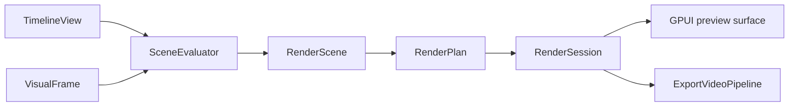

# Architecture

## Workspace

| Crate | Responsibility | Dependencies within the workspace |
| --- | --- | --- |
| [`zerium`](../crates/zerium/src/) | Startup, GPUI entities, media, rendering, export, and project I/O | Core and shader |
| [`zerium-core`](../crates/zerium-core/src/) | Project, property, animation, and plugin models; validation and editing | None |
| [`zerium-shader`](../crates/zerium-shader/src/) | Plugin loading, generated WESL interfaces, and shader compilation | Core |

Core and shader do not depend on GPUI, wgpu, or GStreamer. Within the application,
`app` composes the runtime, `ui` translates input into core commands, and `engine`
handles media and I/O. Engine code must not depend on UI entities.

## Editing and project state

Persistent changes go through `TimelineEditor`, which validates edits, records
history, and advances the project revision. A gesture or paste is one undoable
edit. Selection, preview visibility, playhead, and history are session state.
Rendering reads a `TimelineView`; background work receives immutable
`TimelineSnapshot`s.

Editing, animation, scene bindings, and persistence share `PropertyPath`. Array
elements have stable IDs so reordering preserves their animations and bindings.
Property evaluation applies plugin defaults, scene arguments, animation, and
constraints through a pipeline shared by the inspector, rendering, and audio.

### Selection and editor targets

Selection stores the user's explicit item IDs; seeking, stepping, and playback
never change that set. Clipboard, deletion, grouping, visibility, movement,
animation synchronization, and timeline keyframe editing use this selection.

`active_selected_item_ids` derives the subset at the current frame for preview and
inspector display. The curve pane requires its focused item to be active. Inspector
targets and animation focus persist outside the selected items' time ranges; the
inspector's editing target is independent of timeline selection.

### Animation

Authored key times, repeat periods, and phase offsets use integer frames.
Keyframes lie within a track's span; insertion, movement, exact-key lookup, and
synchronization operate on `Frame` values. Ping-pong periods are even.
`AnimationClock` maps authored frames to timeline time and continuous sample frames,
including repeats. Normalized positions are derived only for UI layout.

Editing exactly on a keyframe changes only that key, regardless of its spacing.
Between keyframes, editing an interval endpoint also updates equal neighboring
values outward from that endpoint; the opposite endpoint remains independent.
Inspector and preview value gestures freeze their target keys when an operation
begins, so crossing another key's value never expands the target set. Coincident
preview handles choose the key nearest the playhead for each property axis.

Inspector value operations coalesce by property and authored key using the normal
history timeout. Switching between exact-key and interval editing resolves new
targets without forcing an Undo boundary. Pauses within an operation do not split
its Undo entry.

Item resizing follows two rules:

- Trimming preserves keys within the new interval. A shrinking boundary adopts
  each key it crosses without sampling interpolated values. Extending retains
  the original endpoint and adds a new endpoint with the same value.
- Stretching uses integer rational arithmetic. Interior keys win collisions with
  endpoints; collisions between interior keys retain the later key and its
  outgoing interpolation.

Scene instances expand at their definition's stretch point by shifting keys.
Visual and audio evaluation use the same expansion operation.

### Persistence and project lifecycle

Project files store property overrides relative to plugin defaults and persist
integer animation data directly. During development, the format version stays
fixed without migrating old representations. Core validates loaded values and
clipboard input; pastes assign fresh IDs. Filesystem access and atomic replacement
belong to [`engine::project_io`](../crates/zerium/src/engine/project_io.rs).

[`ProjectSession`](../crates/zerium/src/project_session.rs) identifies project
generations so results from a replaced project can be ignored.
[`ProjectController`](../crates/zerium/src/app/project_controller.rs) owns file
operations and resets transient state when replacing a project.

## Application state and configuration

[`app::state`](../crates/zerium/src/app/state.rs) defines automatically recorded
`AppState` in `state.json`, such as support reminder history.
[`app::config`](../crates/zerium/src/app/config.rs) defines user-selected settings
as `AppConfig` in `config.json`, including language and support reminder preferences.
Both files live in the user config directory and are created with defaults when
missing. Unspecified configuration options follow application defaults.

[`app::persistence`](../crates/zerium/src/app/persistence.rs) provides the shared
`JsonStore<T>` implementation. `StateStore` and `ConfigStore` are GPUI globals
accessed through `read(cx)` and `update(cx, |value| { ... })`. Updates atomically
save the file before replacing the in-memory value. Load errors are logged;
invalid files are left intact and the corresponding store remains unavailable.

Both stores load together before GPUI startup and are registered when the
application context becomes available. Language selection happens before UI and
font initialization, using the configured override, system locale, or `en-US`.
Language changes take effect on the next launch.

The [settings dialog](../crates/zerium/src/ui/config.rs) edits a draft of
`AppConfig`. Save commits it through `ConfigStore`; Cancel discards the draft.

## Rendering

[`engine/rendering`](../crates/zerium/src/engine/rendering/) shares scene evaluation
and GPU rendering between preview and export.

[`SceneEvaluator`](../crates/zerium/src/engine/rendering/scene/) resolves properties,
media requests, text, scene boundaries, and temporal samples.
[`rendering/gpu`](../crates/zerium/src/engine/rendering/gpu/) lowers the resulting
scene into a render plan and submits its passes asynchronously.
[`RenderRuntime`](../crates/zerium/src/engine/rendering/runtime.rs) manages the
preview session and creates independent export sessions.

The planner interns nodes using descriptions that contain child identities rather
than nested keys. Unchanged nodes retain their identity from the previous frame;
older descriptions are discarded. Duplicate passes reuse their node before pass
data is allocated. Hashing and equality do not traverse the dependency graph.

### Images and bounds

Effects and blending use scene-linear, premultiplied color. Intermediate surfaces
are RGBA16Float; presentation uses RGBA8 sRGB. An item's effects run before its
image is blended into its parent. Scene-instance effects run after its children
are composited.

Each render, compute, and temporal reduction pass is a graph node with its own
logical output bounds. Scene bounds are the union of their children's bounds;
view nodes produce finite camera captures. Normal output and camera captures
share the same scene and effect nodes.

Shader nodes render their complete logical images. Composition and view nodes
select the region needed by their destination. Camera zoom changes raster density
without changing logical bounds. Complete intermediate images must fit the GPU
texture limit, so effects on widely separated groups can require large surfaces.

Images carry logical bounds, raster coverage, and sampling density through paired
texture and metadata bindings. Generated sampling functions use the pair for each
image, including media, text, and render results extending beyond the viewport.
Original sources and temporal accumulations are graph dependencies.

Native media and text frames use a separate image node and a renderer-owned
texture/sampler pipeline. They do not use plugin item properties or shader
registration. Uploaded textures and conversion targets are reused by the session.

### GPU resources

`RenderDevice` shares pipelines across sessions. Each `RenderSession` reuses frame
buffers, render targets, uploaded media, and rendered images.

Item data and item/pass properties are uploaded once per frame. Each shader node
supplies a small uniform for its current output size and raster extent. Composition
nodes own render targets without shader data buffers. Node resources do not copy
frame-wide item or property data.

Raster coverage and dimensions are resolved once, before cache lookup, allocation,
or uniform creation. One image key combines the stable node identity with this
coverage and raster grid. The surface cache shares results across consumers and
root layers, then retains frequently used results from the current frame within
a byte budget. Retained entries own their targets until eviction; other targets
return to the resource pool after submission. Native frame conversions are shared
within a frame independently of the consumer's grid; their targets remain owned
by the input texture pool.

Each node owns one output target. A non-normal composition acquires its backdrop
only when it is encoded. Queue ordering lets compositions of the same size share
one scratch backdrop, including nested compositions and root layers. Scratch
retention is bounded and drops sizes unused by the next frame.

## Media, preview, and export

| Module | Responsibility |
| --- | --- |
| [`engine/media`](../crates/zerium/src/engine/media/) | Reader contracts, image/video/audio readers, and audio timelines |
| [`engine/frame`](../crates/zerium/src/engine/frame/) | Shared visual frames, pixel planes, and color metadata |
| [`engine/gpu.rs`](../crates/zerium/src/engine/gpu.rs) | GPU device/queue ownership and video-capable device creation |
| [`engine/gstreamer`](../crates/zerium/src/engine/gstreamer/) | Discovery, demuxing, software decoding, and MP4 output |
| [`engine/preview`](../crates/zerium/src/engine/preview/) | Decode scheduling and retained frames for interactive playback |
| [`engine/export`](../crates/zerium/src/engine/export/) | Snapshot evaluation, ordered frame processing, and encoding |

Scene evaluation requests media by asset, source time, and raster size. Preview
and export own separate evaluators and decode sessions. Video selection uses
presentation timestamps; images are rasterized at the requested size.

H.264 decoding uses `gpu-video` when available, with a GStreamer software fallback.
GPU-decoded NV12 planes are converted to RGB for rendering. Audio readers feed a
shared timeline mixer; preview sends its output to CPAL and export to the encoder.

### Preview

`PreviewFrameScheduler` tracks demand from the current scene, including temporal
samples. Each input has at most one outstanding decode. Preview displays the
frame covering the requested time, or a retained candidate while waiting.
Changed candidates trigger redraws; unchanged frames skip scene construction and
GPU rendering. Texture preparation and drawing share a GPU queue to preserve
submission order without blocking the UI on GPU completion.

### Export

Export freezes the timeline and processes every output frame in order. Evaluation,
decoding, rendering, and encoding overlap through bounded queues. Rendered output
is converted to limited-range BT.709 NV12. Encoding uses Vulkan Video on Linux and
Windows or VideoToolbox on macOS, with GStreamer's x264 encoder as the fallback
when a GPU encoder cannot be initialized. Later encoder failures are reported.

GStreamer combines H.264 video and AAC audio into MP4. The completed temporary
file is published atomically.

## Plugins

Core owns manifest validation and the editing registry. Shader owns WESL source
resolution, interface generation, and compilation. Each declared module is linked
and structurally validated once, then checked against its pass entry points and
overrides. The application embeds bundled plugins; the plugin CLI uses the same
shader tooling.

Generated sources retain WESL module paths through fingerprinting and loading.
The writer converts those paths to filesystem paths when publishing `generated/`.
The application registers embedded WESL assets in a `VirtualResolver`; filesystem
plugins use WESL's `FileResolver`.

The public host API separates item/effect operations from render, compute, and
temporal operations. Common utilities use `generated::support::util`; GPU layouts
and image bindings live in the private `generated::_internal` namespace.

See [Plugin API v1](plugin.md) for the authoring workflow and
[Rendering and shaders](plugin/rendering.md) for the generated API and image
contract. Field definitions live in the [JSON schema](../plugins/plugin.schema.json);
implementation lives in [`zerium-shader/src`](../crates/zerium-shader/src/).

## Runtime services

- [Localization](../crates/zerium/src/i18n.rs) selects a shared `rust-i18n` locale
  for core and UI labels. User-authored names remain plain text.
- [Logging](../crates/zerium/src/logging.rs) writes process logs to the application's
  state directory and stderr. `RUST_LOG` controls verbosity; the Help menu reveals
  the current log. Panic reports include backtraces.
- The [update service](../crates/zerium/src/app/update/) checks GitHub Releases in the
  background and uses Velopack to apply updates on relaunch. Nix builds disable
  the `self-update` feature.
