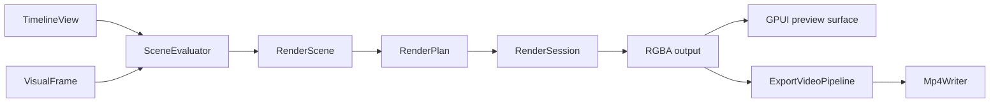

# Architecture

## Workspace

```text
zerium (application)
 ├──> zerium-shader (plugin assets and shader compilation)
 │     └──> zerium-core
 └────────> zerium-core (models and editing)
```

- [`zerium`](../crates/zerium/src/) owns startup, GPUI entities, platform adapters,
  and embedded resources.
- [`zerium-core`](../crates/zerium-core/src/) owns project, property, animation,
  and plugin models, validation, and editing rules.
- [`zerium-shader`](../crates/zerium-shader/src/) loads plugin assets, generates
  WESL interfaces, and validates and compiles shaders.

Core and shader do not depend on GPUI, wgpu, GStreamer, or application code.
Within the application, `app` composes the runtime, `ui` translates user input
into core commands, and `engine` handles media, rendering, export, and project
I/O. Engine code must not depend on UI entities.

## Editing and evaluation

Persistent changes go through `TimelineEditor`. Commands validate values and
bindings before committing, record history, and advance project revision.
Each gesture or paste is one undoable edit. Selection, preview visibility,
playhead, and history are session state; preview-only changes do not advance
project revision or enter history.

Editing, animation, scene bindings, and persistence share `PropertyPath`.
Array elements have stable IDs, so reordering preserves their animations and
bindings. The inspector's editing target is independent of timeline selection.

Property evaluation applies plugin defaults, scene arguments, animation, and
constraints through one pipeline shared by the inspector, rendering, and audio.
Animation tracks address individual scalars; `AnimationClock` maps pattern
positions to timeline time, including repeats. Beat guides affect editing only.

## Sessions and persistence

Rendering reads through `TimelineView`; background work receives immutable
`TimelineSnapshot`s. `ProjectSession` identifies project generations so results
from a replaced project can be ignored. `ProjectController` owns file-operation
lifetimes and resets transient state when replacing a project. Reopening a
project invalidates old edit targets.

Project files store property overrides relative to plugin defaults. Loading
validates input and applies overrides to current defaults. Filesystem access
and atomic replacement belong to `engine::project_io`.

Clipboard input uses the same validation as project input. Item and effect
pastes assign fresh IDs and go through the usual editing commands.

## Plugins

Core validates manifests and provides registry lookup. Shader loads bundles
and validates shader compatibility. The application embeds bundled plugins;
plugin CLI commands use the same implementation. See [Plugin API v1](plugin.md)
for the authoring contract.

Core's plugin registry contains manifests and editing schemas. Shader owns each
bundle's WESL resolver: filesystem bundles use WESL's `FileResolver`, and embedded
bundles retrieve source assets when a module is requested. Compilation works with
module names and resolves imports through the same path. Plugin authors choose
their shader directory layout; `generated/` contains the host-defined interfaces.

GPU property blocks contain numeric values, colors, and their arrays; strings and
files remain CPU values. Pass overrides use WGSL declarations and wgpu pipeline
compilation options. Shader tooling separates source resolution, interface
generation, WGSL validation, and renderer descriptions. During compilation, each
declared module is linked, parsed, and structurally validated once; each pass
checks its entry points and specialization values against that module. Compute
dispatch dimensions reflect the specialized workgroup size. Generation and bundle
loading derive the same interfaces from core property layouts. See
[`zerium-shader`](../crates/zerium-shader/README.md) for module responsibilities.

## Media

| Module | Responsibility |
| --- | --- |
| [`engine/media`](../crates/zerium/src/engine/media/) | Reader contracts, image/video/audio readers, metadata, and audio timelines |
| [`engine/frame`](../crates/zerium/src/engine/frame/) | Shared visual-frame storage, pixel planes, and color conversion metadata |
| [`engine/media/video`](../crates/zerium/src/engine/media/video/) | Presentation-time selection, GPU decoding, and CPU fallback |
| [`engine/gstreamer/input`](../crates/zerium/src/engine/gstreamer/input/) | Discovery, demuxing, H.264 parsing, and software decoder pipelines |
| [`engine/gstreamer/encoding`](../crates/zerium/src/engine/gstreamer/encoding/) | MP4 output, AAC encoding, and x264 encoding of raw NV12 input |

Scene construction resolves media inputs into `MediaFrameRequest`s containing
an asset, source time, and raster size. Preview and export use the same
`VisualDecodeSession` implementation with independent sessions. Each session reuses
its decoder while the asset remains unchanged.

Video decodes at source resolution and selects frames by actual presentation
timestamps. Nearby forward requests continue decoding; backward and distant
requests seek to a preceding keyframe. Image readers honor requested raster sizes.

Decoder sessions receive the consumer's GPU device and queue. GStreamer reads
and parses H.264 access units; `gpu-video` decodes them into wgpu NV12 textures
using Vulkan Video on Linux and Windows, or VideoToolbox on macOS. Unsupported
streams, unavailable GPU decoders, and decode failures select GStreamer software
decoding for the session. Seeking discards pending pictures and resumes at a
preceding keyframe while reusing the GPU decoder's session and surfaces.
Rendering converts decoded planes into an owned RGB texture.
Input decoding and export encoding select their backends independently.

Audio readers feed a shared timeline mixer. Preview sends mixed audio to CPAL;
export sends it to the audio encoder.

## Rendering

[`engine/rendering`](../crates/zerium/src/engine/rendering/) shares scene
construction and GPU rendering between preview and export. `SceneEvaluator`
evaluates a `TimelineView`, resolves visual inputs through the consumer's media
callback, and rasterizes text. Each consumer owns its evaluator and decode sessions.

| Module | Responsibility |
| --- | --- |
| [`rendering/scene`](../crates/zerium/src/engine/rendering/scene/) | Timeline evaluation, scene graphs, logical bounds, and text rasterization |
| [`rendering/gpu`](../crates/zerium/src/engine/rendering/gpu/) | Render plans, shader pipelines, command encoding, and texture/resource pools |
| [`engine/gpu.rs`](../crates/zerium/src/engine/gpu.rs) | Device/queue ownership and video-capable GPU creation |
| [`export/video`](../crates/zerium/src/engine/export/video/) | Rendered-output conversion, GPU video encoding, and NV12 readback |

`GpuContext` pairs one device with its queue. `RenderDevice` owns shared shader
pipelines and immutable rendering state; `RenderSession` owns a consumer's
resource pools. GPU rendering lowers a `RenderScene` into a `RenderPlan`, encodes
its passes, and submits them through `RenderSession::submit_scene`. Submission is
asynchronous. Intermediate surfaces use RGBA16Float; presentation uses RGBA8 sRGB.
[`app/gpu.rs`](../crates/zerium/src/app/gpu.rs) adapts GPUI's surface-device factory
to the engine's GPU setup.



Rendering names describe ownership and work: `Device` owns shared GPU state,
`Session` owns consumer-local state, `Evaluator` builds a scene, and `Pipeline`
encodes a defined GPU or export stage. Decoder traits describe media interfaces;
`DecodeSession` implementations own persistent decoder state. Backend modules
use API names such as `gpu_video` and `video_toolbox`. `VisualFrame` describes
frame content and `DecodedFrame` adds presentation timing.

Timeline evaluation preserves scene boundaries and temporal effect samples.
Effects and blending operate in scene-linear light with premultiplied alpha.
Each item's completed surface is blended into its parent after its effects;
scene-instance effects run after their children are composited.

## Preview

[`engine/preview`](../crates/zerium/src/engine/preview/)
owns `PreviewFrameScheduler`, which schedules frames needed by the current scene
during playback, scrubbing, and stopping. Each input has at most one outstanding decode. When
demand changes, that decode finishes and its result is published before the next
request is selected from the latest demand.

Preview retains candidate frames for the times requested by the current scene,
including temporal effect samples. It displays the frame covering the requested
time, or the closest retained frame while waiting.
Workers submit video texture preparation before publishing results to the UI.
Conversion and drawing use the same GPU queue, so queue ordering preserves
dependencies without making workers wait for GPU completion. The UI
updates demand and redraws when the displayed candidate changes; unchanged
frames skip scene construction and GPU rendering.

## Export

[`engine/export`](../crates/zerium/src/engine/export/) freezes the timeline
at export start and processes every output frame in order. Scene evaluation
and decoding, GPU rendering, and encoding overlap through bounded queues.
Export owns its evaluator, decoder sessions, and `RenderSession` independently
of preview. `ExportVideoPipeline` renders scenes and converts output to encoder
input. `VideoEncoderFrame` carries a frame index and either raw NV12 bytes or an
H.264 access unit; `VideoEncoderInput` selects the MP4 writer's input contract.

The GPU converts rendered output to limited-range BT.709 NV12. Linux and Windows
use `gpu-video` for Vulkan Video encoding; macOS uses VideoToolbox. Unsupported
GPUs or encoder initialization failures select CPU readback and GStreamer's
x264 encoder. The backend stays fixed for the export; subsequent failures
are reported.

`Mp4Writer` uses GStreamer to combine H.264 video and AAC audio into MP4. Audio timing
is adjusted to account for encoder priming. Output is written to a temporary
file and published atomically only after successful completion.

## Localization

Startup selects a shared `rust-i18n` locale for core labels and the UI.
User-authored names are plain text; translated defaults come from the UI.
Plugin label lookup is described in [Plugin API v1](plugin.md#manifest).

## Application updates

The app checks GitHub Releases in the background. Velopack applies pending
updates before startup on the next launch, preserving launch arguments.
Nix builds disable the `self-update` feature.
