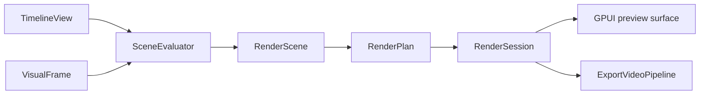

# Architecture

## Workspace

| Crate | Responsibility | Dependencies within the workspace |
| --- | --- | --- |
| [`zerium`](../crates/zerium/src/) | Startup, GPUI entities, media, rendering, export, and project I/O | Core and shader |
| [`zerium-core`](../crates/zerium-core/src/) | Project, property, animation, and plugin models; validation and editing | None |
| [`zerium-shader`](../crates/zerium-shader/src/) | Plugin loading, generated WESL interfaces, and shader compilation | Core |

Core and shader do not depend on GPUI, wgpu, or GStreamer. Within the application,
`app` composes the runtime, `ui` translates input into core commands, and `engine`
handles media and I/O. Engine code must not depend on UI entities.

## Editing and project state

Persistent changes go through `TimelineEditor`, which validates edits, records
history, and advances the project revision. A gesture or paste is one undoable
edit. Selection, preview visibility, playhead, and history are session state.

Editing, animation, scene bindings, and persistence share `PropertyPath`. Array
elements have stable IDs so reordering preserves their animations and bindings.
The inspector's editing target is independent of timeline selection.

Property evaluation applies plugin defaults, scene arguments, animation, and
constraints through a pipeline shared by the inspector, rendering, and audio.
`AnimationClock` maps scalar tracks to timeline time, including repeats. Scene
instances expand at their definition's stretch point through the same operation
for visual and audio evaluation.

Rendering reads a `TimelineView`; background work receives immutable
`TimelineSnapshot`s. [`ProjectSession`](../crates/zerium/src/project_session.rs)
identifies project generations so results from a replaced project can be ignored.
[`ProjectController`](../crates/zerium/src/app/project_controller.rs) owns file
operations and resets transient state when replacing a project.

Project files store property overrides relative to plugin defaults. Core validates
loaded values and clipboard input; pastes assign fresh IDs. Filesystem access and
atomic replacement belong to
[`engine::project_io`](../crates/zerium/src/engine/project_io.rs).

## Application state and configuration

[`app::state`](../crates/zerium/src/app/state.rs) defines automatically recorded
`AppState` in `state.json`, such as support reminder history.
[`app::config`](../crates/zerium/src/app/config.rs) defines user-selected settings
as `AppConfig` in `config.json`, including language and support reminder preferences.
Both files live in the user config directory and are created with defaults when
missing. Unspecified configuration options follow application defaults.

[`app::persistence`](../crates/zerium/src/app/persistence.rs) provides the shared
`JsonStore<T>` implementation. `StateStore` and `ConfigStore` are GPUI globals
accessed through `read(cx)` and `update(cx, |value| { ... })`. Updates atomically
save the file before replacing the in-memory value. Load errors are logged;
invalid files are left intact and the corresponding store remains unavailable.

Both stores load together before GPUI startup and are registered when the
application context becomes available. Language selection happens before UI and
font initialization, using the configured override, system locale, or `en-US`.
Language changes take effect on the next launch.

The [settings dialog](../crates/zerium/src/ui/config.rs) edits a draft of
`AppConfig`. Save commits it through `ConfigStore`; Cancel discards the draft.

## Rendering

[`engine/rendering`](../crates/zerium/src/engine/rendering/) shares scene evaluation
and GPU rendering between preview and export.

[`SceneEvaluator`](../crates/zerium/src/engine/rendering/scene/) resolves properties,
media requests, text, scene boundaries, and temporal samples.
[`rendering/gpu`](../crates/zerium/src/engine/rendering/gpu/) lowers the resulting
scene into a render plan and submits its passes asynchronously. `RenderDevice`
owns shared pipelines; each `RenderSession` owns its resource pools.
[`RenderRuntime`](../crates/zerium/src/engine/rendering/runtime.rs) manages the
preview session and creates independent export sessions.

Effects and blending use scene-linear, premultiplied color. Intermediate surfaces
are RGBA16Float; presentation uses RGBA8 sRGB. Each item's effects run before its
completed surface is blended into its parent. Scene-instance effects run after
its children are composited.

## Media, preview, and export

| Module | Responsibility |
| --- | --- |
| [`engine/media`](../crates/zerium/src/engine/media/) | Reader contracts, image/video/audio readers, and audio timelines |
| [`engine/frame`](../crates/zerium/src/engine/frame/) | Shared visual frames, pixel planes, and color metadata |
| [`engine/gpu.rs`](../crates/zerium/src/engine/gpu.rs) | GPU device/queue ownership and video-capable device creation |
| [`engine/gstreamer`](../crates/zerium/src/engine/gstreamer/) | Discovery, demuxing, software decoding, and MP4 output |
| [`engine/preview`](../crates/zerium/src/engine/preview/) | Decode scheduling and retained frames for interactive playback |
| [`engine/export`](../crates/zerium/src/engine/export/) | Snapshot evaluation, ordered frame processing, and encoding |

Scene evaluation requests media by asset, source time, and raster size. Preview
and export own separate evaluators and decode sessions. Video selection uses
presentation timestamps; images are rasterized at the requested size.

H.264 decoding uses `gpu-video` when available, with a GStreamer software fallback.
GPU-decoded NV12 planes are converted to RGB for rendering. Audio readers feed a
shared timeline mixer; preview sends its output to CPAL and export to the encoder.

### Preview

`PreviewFrameScheduler` tracks demand from the current scene, including temporal
samples. Each input has at most one outstanding decode. Preview displays the
frame covering the requested time, or a retained candidate while waiting.
Changed candidates trigger redraws; unchanged frames skip scene construction and
GPU rendering. Texture preparation and drawing share a GPU queue to preserve
submission order without blocking the UI on GPU completion.

### Export

Export freezes the timeline and processes every output frame in order. Evaluation,
decoding, rendering, and encoding overlap through bounded queues. Rendered output
is converted to limited-range BT.709 NV12. Encoding uses Vulkan Video on Linux and
Windows or VideoToolbox on macOS, with GStreamer's x264 encoder as the fallback
when a GPU encoder cannot be initialized. Later encoder failures are reported.

GStreamer combines H.264 video and AAC audio into MP4. The completed temporary
file is published atomically.

## Plugins

Core owns manifest validation and the editing registry. Shader owns WESL source
resolution, interface generation, and compilation. Each declared module is linked
and structurally validated once, then checked against its pass entry points and
overrides. The application embeds bundled plugins; the plugin CLI uses the same
shader tooling.

See [Plugin API v1](plugin.md) for authoring, the
[JSON schema](../plugins/plugin.schema.json) for declaration fields, and
[`zerium-shader/src`](../crates/zerium-shader/src/) for implementation.

## Runtime services

- [Localization](../crates/zerium/src/i18n.rs) selects a shared `rust-i18n` locale
  for core and UI labels. User-authored names remain plain text.
- [Logging](../crates/zerium/src/logging.rs) writes process logs to the application's
  state directory and stderr. `RUST_LOG` controls verbosity; the Help menu reveals
  the current log. Panic reports include backtraces.
- The [update service](../crates/zerium/src/app/update/) checks GitHub Releases in the
  background and uses Velopack to apply updates on relaunch. Nix builds disable
  the `self-update` feature.
