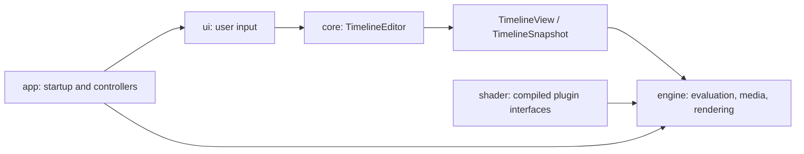

# Architecture

[Documentation](../README.md) · **Architecture** · [Plugin authoring](../plugin/README.md)

## Workspace boundaries

| Crate | Responsibility | Workspace dependencies |
| --- | --- | --- |
| [`zerium`](../../crates/zerium/src/) | Startup, GPUI entities, media, rendering, export, and project I/O | Core and shader |
| [`zerium-core`](../../crates/zerium-core/src/) | Project, property, animation, and plugin models; validation and editing | None |
| [`zerium-shader`](../../crates/zerium-shader/src/) | Plugin loading, generated WESL interfaces, and shader compilation | Core |

Core and shader do not depend on GPUI, wgpu, or GStreamer. Within the application,
`app` composes the runtime, `ui` translates input into core commands, and `engine`
handles media and I/O. Engine code must not depend on UI entities.

## Implementation guides

| Guide | Contents |
| --- | --- |
| [Editing and project state](editing.md) | Transactions, property contracts, selection, animation, scenes, and project lifecycle |
| [Rendering](rendering.md) | Scene evaluation, render graphs, image bounds, caches, and GPU ownership |
| [Media, preview, and export](media.md) | Reader contracts, decode scheduling, playback, and export backends |
| [Runtime services](runtime.md) | Startup, application configuration, plugin compilation, logging, and updates |

Plugin declaration and shader contracts are documented in the
[authoring guide](../plugin/README.md).

## Source layout

Feature modules keep their state, operations, and presentation together. Their
application-facing entry points remain at the feature root. Shared helpers stay
within the feature that owns them, with visibility limited to their callers.

Modules with children use a directory and `mod.rs`; leaf modules use `<name>.rs`.
Separate methods with a blank line, including declarations in traits.

| Area | Entry point and internal boundaries |
| --- | --- |
| [Application composition](../../crates/zerium/src/app/) | `bootstrap.rs` creates entities; project, media metadata, persistence, configuration, and updates have separate controllers or modules. |
| [Timeline commands](../../crates/zerium-core/src/timeline/commands/) | Editing operations, shared gestures, and value transactions. Scene and argument commands live under `scene/`. |
| [Scenes](../../crates/zerium-core/src/timeline/scene/) | `mod.rs` owns definitions; `argument.rs`, `binding.rs`, and `expansion.rs` own argument contracts, bindings, and instance expansion. |
| [Timeline pane](../../crates/zerium/src/ui/timeline/) | `mod.rs` owns the entity; `render/`, `interaction/`, `ruler.rs`, and `viewport.rs` separate drawing, input, grids, and geometry. |
| [Inspector](../../crates/zerium/src/ui/property_inspector/) | `control.rs` describes controls; `state.rs` retains input entities; `rows/` owns widgets and layouts by value type. |
| [Animation curve](../../crates/zerium/src/ui/animation_curve/) | Curve selection, editing, viewport interaction, repeat controls, and rendering surround one editor entity. |
| [Explorer](../../crates/zerium/src/ui/explorer/) | Directory loading, navigation, selection, and rendering; `render.rs` also owns drag previews. |
| [Export UI](../../crates/zerium/src/ui/export/) | `dialog.rs` owns settings and destination selection; `job.rs` owns execution, progress, and cancellation. |
| [Rendering engine](../../crates/zerium/src/engine/rendering/) | `scene/` builds evaluated graphs; `gpu/` plans and executes them; `runtime.rs` owns preview and export sessions. |

Reader and encoding modules are mapped in [Media and export](media.md).
