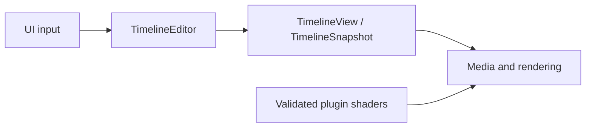

# Architecture

[Documentation](../README.md) · **Architecture** · [Plugin authoring](../plugin/README.md)

## Workspace boundaries

| Crate | Responsibility | Workspace dependencies |
| --- | --- | --- |
| [`zerium`](../../crates/zerium/src/) | Application workflows, UI, and the media engine | Core and shader |
| [`zerium-core`](../../crates/zerium-core/src/) | Project models, editing, evaluation, persistence, and plugin contracts | None |
| [`zerium-shader`](../../crates/zerium-shader/src/) | Plugin loading, interface generation, WESL translation, and shader validation | Core |

Core and shader have no GPUI, wgpu, or GStreamer dependency. In the application,
`app` owns project lifecycle and consumer workflows, `ui` translates input into
application and core operations, and `engine` owns media processing and native
backends. Engine code does not depend on application controllers or UI entities.

## Implementation guides

| Guide | Contents |
| --- | --- |
| [Editing and project state](editing.md) | Transactions, scene variables, animation, Undo, and persistence |
| [Rendering](rendering.md) | Evaluation, render planning, bounds, and GPU ownership |
| [Media, preview, and export](media.md) | Readers, decode scheduling, audio, and export |
| [Runtime services](runtime.md) | Startup, configuration, plugin validation, and updates |

## Source layout

The core timeline separates authored data and invariants in
[`model`](../../crates/zerium-core/src/timeline/model/), commands and history in
[`editing`](../../crates/zerium-core/src/timeline/editing/), and consumer read models in
[`evaluation`](../../crates/zerium-core/src/timeline/evaluation/). Model code does
not depend on editing or evaluation.

The engine is grouped by processing stage:
[`input`](../../crates/zerium/src/engine/input/) discovers and decodes sources,
[`processing`](../../crates/zerium/src/engine/processing/) mixes audio and renders
images, and [`output`](../../crates/zerium/src/engine/output/) plays audio and
encodes files. Preview and export workflows live in `app`; native integrations
stay with the engine stages that use them. Shared GPU resources and native
runtime initialization belong to the engine parent.

Modules with children use `mod.rs`. Sibling modules describe concepts at the same
layer; shared contracts and small helpers stay with their owning parent.
