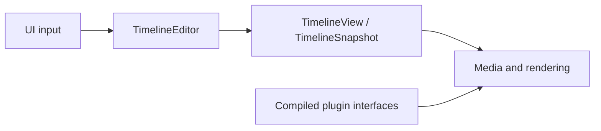

# Architecture

[Documentation](../README.md) · **Architecture** · [Plugin authoring](../plugin/README.md)

## Workspace boundaries

| Crate | Responsibility | Workspace dependencies |
| --- | --- | --- |
| [`zerium`](../../crates/zerium/src/) | Application, UI, media, rendering, and I/O | Core and shader |
| [`zerium-core`](../../crates/zerium-core/src/) | Project models, plugin contracts, validation, and editing | None |
| [`zerium-shader`](../../crates/zerium-shader/src/) | Plugin loading, WESL generation, and shader compilation | Core |

Core and shader have no GPUI, wgpu, or GStreamer dependency. In the application,
`app` wires controllers and services, `ui` translates input into core commands,
and `engine` executes media, rendering, and I/O work. Engine code does not depend
on UI entities.

## Implementation guides

| Guide | Contents |
| --- | --- |
| [Editing and project state](editing.md) | Transactions, scene variables, animation, Undo, and persistence |
| [Rendering](rendering.md) | Evaluation, render planning, bounds, and GPU ownership |
| [Media, preview, and export](media.md) | Readers, decode scheduling, audio, and export |
| [Runtime services](runtime.md) | Startup, configuration, plugin compilation, and updates |

## Source layout

Feature directories keep state, operations, and presentation together, with
application-facing entry points at the feature root. Shared helpers stay with
their owning feature and use the narrowest visibility their callers need.

Start with [`timeline/commands`](../../crates/zerium-core/src/timeline/commands/)
for editing, [`timeline/scene`](../../crates/zerium-core/src/timeline/scene/)
for scene variables, [`ui`](../../crates/zerium/src/ui/) for panes and input, or
[`engine`](../../crates/zerium/src/engine/) for runtime work.
