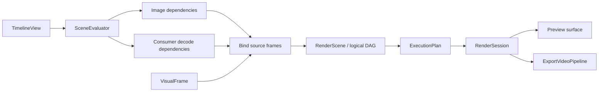

# Rendering

[Architecture](README.md) · [Editing](editing.md) · **Rendering** · [Media and export](media.md) · [Runtime](runtime.md)

Preview and export share [`engine/rendering`](../../crates/zerium/src/engine/rendering/):

## Scene evaluation and render planning

`SceneEvaluator` builds image dependencies from the requested output backward.
An image request names a stable scene-instance path, an output or a boundary
before an `EffectInstanceId`, an absolute item-local time, and a raster scale.
Ordinary effects request their upstream image at the same time. Sampling effects
evaluate their controls at the consuming time and request
the upstream stage at the selected source times. Unused current-time upstream
images and their properties never enter the graph.

Core `RenderEvaluation` separates placement lookup from property evaluation.
Paths resolve directly by ID, expanding only the instances along that path;
composition enumeration visits only the requested scope. Item and effect values
resolve independently as `ResolvedRenderProperties`: values and diagnostics for
one owner and purpose, without reconstructing a partial `EvaluatedItem`. Visual
items evaluate only `render.properties`; audio-only controls do not run at visual
sample times. Capture ranges and hide-original flags resolve separately because
they determine normal-output visibility and layer dependencies. Camera position,
zoom and angle are image properties: they resolve only at the time of a consumed
capture, never during composition topology enumeration. Composition planning consumes
explicit capture definitions alongside placements. Property evaluations are
shared across equal time and owner requests. Core owns one canonical expanded
placement per instance path, including its parent and runtime ID. Composition
enumeration selects source IDs and uses the same placement pool as direct lookup
and property evaluation; it never independently clones and expands those items.

Every image request uses the target item's full expanded interval. Ancestor
output intervals do not restrict upstream samples, including nested sampling and
render-result captures. Requests outside the target's own interval return no
image. Normal output is still limited by each composition boundary: a scene's
image exists only during its own interval, and its children are composed only
when that image is requested. Enumerating a scope's contents for a capture does
not request the scope's output, so it can reach a child beyond the scope's output
interval. Core maps the target's local time through its owning scene scopes,
including animated instance arguments. Progress only converts 0–1 to
`p * (duration - 1)`; it does not choose a clipping or decoder policy.

A shaderless `sample` pass requests one image directly. A `temporal` pass reduces
multiple images with a shader. Both use the same stage-request path and retain ancestor
stage boundaries, identified by effect instance IDs. Logical source, composition,
and effect nodes have explicit dependencies. A pure single sample aliases its
upstream node without a logical effect node, shader property packing or copy pass,
so a fixed source time has a stable image identity even while the playhead moves.
Reducers retain their temporal metadata
in cache keys because their shaders can read it.

Texture inputs inherit their consumer's requested raster scale, including
render-result captures and the children composed into them. Sampling one image
and reducing multiple images share stage boundaries, decoder branch creation and
resource limits without constructing reduction metadata for a single sample.

Image planning does not invoke decoders. Its cache keys contain only image
semantics, and frame leaves contain unresolved source requests. A separate demand
DAG records consumer edges, including sampling edges of pure aliases. Traversing
that DAG attaches stable decoder branches to source requests, including every
branch that reaches an already shared image. Complete requests are deduplicated
before calling preview/export; returned frames then bind the planned leaves.
Each image builds an owned `ImageDemand` and returns a `PlannedImage` containing
both its image and demand identity. Parents explicitly record ordinary or sampled
inputs; recursion never swaps a global current consumer. Media slots have their
own typed IDs, independent of render-node indices. Demand traversal therefore
does not inspect render-node variants to recover media requests. Image memoization
has explicit resolving and completed states for cycle detection and reuse.
Temporal depth and sample limits also apply to this traversal, so sharing an
image cannot bypass consumer-path limits. Missing inputs share a stable transparent
frame rather than invalidating rendered-image caches on every evaluation.

Text frames are keyed by their full content, style and raster dimensions, with
hash lookup and a separate ordered recency index under one byte budget. Identical
signatures share pixels across sources as well as sampling times. Render graphs
pin the exact versions they consume; unreferenced versions are evicted in
least-recently-used order. If live versions fill the budget, a new frame is
returned without entering the cache. Nonfinite style values are rejected and
signed zero hashes consistently with numeric equality.

Placed items and scene instances receive placement-specific runtime IDs, keeping
media inputs independent across repeated scene placements. Composition planning
resolves layer-relative captures in each scene scope. Normal output and captures
have separate node lists, so hiding an original does not remove it from other
capture dependencies. Export checks failures only on consumed stages and topology.

`RenderGraph` interns equivalent nodes using child identities. Composition order
and blend modes belong to occurrences, independently of shared image nodes.
`ExecutionPlan` resolves node requests into physical surfaces using raster
coverage and sampling density. Equal requests share work; retained cache hits
stop traversal. Only visible, uncached work prepares properties and input images.
GPU encoding follows the plan's dependency and composition order.

## Images and bounds

Effects and blending use scene-linear, premultiplied color. Intermediate surfaces
are RGBA16Float; presentation uses RGBA8 sRGB. Item effects run before blending
into the parent; scene-instance effects run after their children are composited.

Each shader pass has logical output bounds. Scene bounds are their children's
union. Shader nodes render complete images; composition and camera nodes choose
the region needed by the destination. Camera zoom changes sampling density, not
logical bounds. Scene boundaries do not clip content; final output and camera
views do. Every intermediate surface must fit the GPU texture limit, including
effects on groups with widely separated children.

Images pair textures with logical bounds, raster coverage, and density. Native
media and text use renderer-owned image nodes; plugin shaders sample them through
generated interfaces. The text cache owns shaping, font fallback, glyph resources,
and bounded frame reuse. See the [shader contract](../plugin/rendering.md) for
coordinates and sampling functions.

## GPU resources

`RenderDevice` shares pipelines. Each `RenderSession` owns reusable buffers,
targets, uploaded media, and rendered-image caches in one `RenderState`. Planning,
input preparation, submission and recycling use the same session lock. Texture
resources receive exclusive mutable access and have no separate lock or fallible
post-submission recycling step. Preview and export use separate sessions.
Background video preparation uses a `VideoFrameUploader` with its own conversion
scratch and lock. It shares immutable pipelines with the rendering device, owns
queue submission before publication, and has no scene targets or planning state.
Both paths use the same input validation and texture-upload implementation.

Output or composition-size changes invalidate rendered images. The execution
plan controls uploads, surface lifetimes, and cache retention within a byte
budget. Fully cached frames need no property uploads or input preparation.
Retained results own their targets until eviction; other targets return to the
pool after their final consumer. Native-frame conversion resources stay with the
input texture pool.

Uniform writes follow command order. Non-normal blending acquires its backdrop
when encoded, allowing queue-ordered compositions to share a bounded scratch
pool. Media scheduling and encoding are described in [Media and export](media.md).
