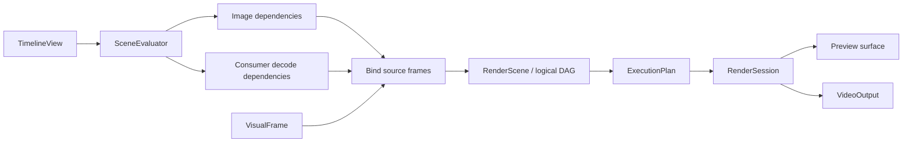

# Rendering

[Architecture](README.md) · [Editing](editing.md) · **Rendering** · [Media and export](media.md) · [Runtime](runtime.md)

Preview and export share [`engine/processing/visual`](../../crates/zerium/src/engine/processing/visual/):

## Scene evaluation and render planning

`SceneEvaluator` builds image dependencies from the requested output backward.
An image request names a stable scene-instance path, an output or a boundary
before an `EffectInstanceId`, an absolute item-local time, and a raster scale.
Ordinary effects request their upstream image at the same time. Sampling effects
evaluate their controls at the consuming time and request the upstream stage at
the selected source times. Unused current-time upstream images and their
properties never enter the graph.

Core `RenderEvaluation` resolves placements by scene-instance path and evaluates
item and effect properties independently. Visual items evaluate only
`render.properties`. Capture ranges and hide-original flags determine composition
topology; camera transforms are evaluated at the time of the consumed image.
Placements and property evaluations are shared within an evaluation.

Image requests use the target item's full duration after scene expansion.
Requests outside that interval return no image. Ancestor output intervals limit
normal composition, but do not restrict sampled child sources. This also applies
to render-result captures: a capture can reach a child outside its parent's
output interval. Sampling the parent scene's image still respects that scene's
own interval. Instance bindings resolve at the requested source time.

A shaderless `sample` pass selects one upstream image; a `temporal` pass combines
several images with a shader. Both retain ancestor effect-stage boundaries during
nested sampling. An effect containing only a `sample` pass aliases its upstream
node. Temporal reductions include their sample metadata in image identity because
shaders can read it.
Texture inputs and captured children inherit the consumer's requested raster scale.
Each scene node stores the resolved scale once, including its input requirements;
item, effect, and composition contents do not retain separate copies.
See [Sampling one image](../plugin/rendering.md#sampling-one-image) for time mapping.

Image planning builds a separate demand DAG for decoder scheduling. Image keys
describe pixel dependencies; demand edges retain each sampling consumer's decoder
branch, even when consumers share an image. Planning validates temporal depth and
sample limits before invoking decoders. Traversing demand produces deduplicated
source requests; preview or export supplies frames to bind the image graph.
See [Media and export](media.md#preview) for stream identity and scheduling.

Placed items and scene instances receive placement-specific runtime IDs, keeping
media inputs independent across repeated scene placements. Composition planning
resolves layer-relative captures in each scene scope. Normal output and captures
have separate node lists, so hiding an original does not remove it from other
capture dependencies. Export checks failures only on consumed stages and topology.

`RenderGraph` interns equivalent nodes using child identities. Composition order
and blend modes belong to occurrences, independently of shared image nodes.
`ExecutionPlan` resolves node requests into physical surfaces using raster
coverage and sampling density. Equal requests share work; retained cache hits
stop traversal. Only visible, uncached work prepares properties and input images.
GPU encoding follows the plan's dependency and composition order.

## Images and bounds

Effects and blending use scene-linear, premultiplied color. Intermediate surfaces
are RGBA16Float; presentation uses RGBA8 sRGB. Export requests the scene-linear
format directly, preserving precision and highlight values for its output transform. Item effects run before blending
into the parent; scene-instance effects run after their children are composited.

Each shader pass has logical output bounds. Scene bounds are their children's
union. Shader nodes render complete images; composition and camera nodes choose
the region needed by the destination. Camera zoom changes sampling density, not
logical bounds. Scene boundaries do not clip content; final output and camera
views do. Every intermediate surface must fit the GPU texture limit, including
effects on groups with widely separated children.

Images pair textures with logical bounds, raster coverage, and density. Native
media and text use renderer-owned image nodes; plugin shaders sample them through
generated interfaces. The text cache owns shaping, font fallback, glyph resources,
and bounded frame reuse. See the [shader contract](../plugin/rendering.md) for
coordinates and sampling functions.

## GPU resources

[`RenderRuntime`](../../crates/zerium/src/app/rendering.rs) selects GPU devices and
creates preview and export sessions. `RenderDevice` shares pipelines. Each
`RenderSession` owns its mutable resources in one `RenderState`; planning, input
preparation, submission, and recycling use the same session lock. Preview and export use separate sessions.
Export appends color conversion and any readback copies to the scene's command
encoder, then submits them together before releasing session resources.
Device creation consumes read-only shader descriptions produced by validation.
Temporal sampling is lowered into ordinary render passes with sample metadata;
it shares raster pipeline creation and storage with other effects.
Background video preparation uses a `VideoFrameUploader` with independent
conversion scratch. It shares pipelines and upload code with rendering, and
submits converted frames before workers publish them.

Output or composition-size changes invalidate rendered images. The execution
plan controls uploads, surface lifetimes, and cache retention within a byte
budget. Fully cached frames need no property uploads or input preparation.
Retained results own their targets until eviction; other targets return to the
pool after their final consumer. Native-frame conversion resources stay with the
input texture pool.

Uniform writes follow command order. Non-normal blending acquires its backdrop
when encoded, allowing queue-ordered compositions to share a bounded scratch
pool. Media scheduling and encoding are described in [Media and export](media.md).
