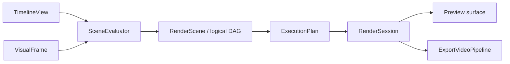

# Rendering

[Architecture](README.md) · [Editing](editing.md) · **Rendering** · [Media and export](media.md) · [Runtime](runtime.md)

Preview and export share [`engine/rendering`](../../crates/zerium/src/engine/rendering/):

## Scene evaluation and render planning

`SceneEvaluator` resolves properties, media, text, composition scopes, and temporal
samples. Visual items evaluate only `render.properties`, the same contract used
for shader packing, bounds, and visual inputs. Audio-only controls do not run at
visual sample times.

Temporal requests evaluate the image before the consuming effect. Later effects
are removed before property and capture resolution, so their calculations cannot
affect that sample. Limits use stable scene-instance paths and visible effect
counts; nested requests retain ancestor limits. Evaluation caches include both
time and effect stage.

Placed items and scene instances receive placement-specific runtime IDs, keeping
media and text independent across repeated scene placements. Composition planning
resolves layer-relative captures in each scene scope. Normal output and captures
have separate node lists, so hiding an original does not remove it from other
capture dependencies. Export checks failures only on consumed nodes.

`RenderGraph` interns equivalent nodes using child identities. Composition order
and blend modes belong to occurrences, independently of shared image nodes.
`ExecutionPlan` resolves node requests into physical surfaces using raster
coverage and sampling density. Equal requests share work; retained cache hits
stop traversal. Only visible, uncached work prepares properties and input images.
GPU encoding follows the plan's dependency and composition order.

## Images and bounds

Effects and blending use scene-linear, premultiplied color. Intermediate surfaces
are RGBA16Float; presentation uses RGBA8 sRGB. Item effects run before blending
into the parent; scene-instance effects run after their children are composited.

Each shader pass has logical output bounds. Scene bounds are their children's
union. Shader nodes render complete images; composition and camera nodes choose
the region needed by the destination. Camera zoom changes sampling density, not
logical bounds. Scene boundaries do not clip content; final output and camera
views do. Every intermediate surface must fit the GPU texture limit, including
effects on groups with widely separated children.

Images pair textures with logical bounds, raster coverage, and density. Native
media and text use renderer-owned image nodes; plugin shaders sample them through
generated interfaces. The text cache owns shaping, font fallback, glyph resources,
and bounded frame reuse. See the [shader contract](../plugin/rendering.md) for
coordinates and sampling functions.

## GPU resources

`RenderDevice` shares pipelines. Each `RenderSession` owns reusable buffers,
targets, uploaded media, and rendered-image caches. Planning and submission are
serialized within a session. Preview and export use separate sessions.

Output or composition-size changes invalidate rendered images. The execution
plan controls uploads, surface lifetimes, and cache retention within a byte
budget. Fully cached frames need no property uploads or input preparation.
Retained results own their targets until eviction; other targets return to the
pool after their final consumer. Native-frame conversion resources stay with the
input texture pool.

Uniform writes follow command order. Non-normal blending acquires its backdrop
when encoded, allowing queue-ordered compositions to share a bounded scratch
pool. Media scheduling and encoding are described in [Media and export](media.md).
