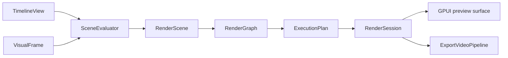

# Rendering

[Architecture](README.md) · [Editing](editing.md) · **Rendering** · [Media and export](media.md) · [Runtime](runtime.md)

[`engine/rendering`](../../crates/zerium/src/engine/rendering/) shares scene evaluation
and GPU rendering between preview and export.

[`SceneEvaluator`](../../crates/zerium/src/engine/rendering/scene/) resolves properties,
media requests, text, scene boundaries, and temporal samples.
[`rendering/gpu`](../../crates/zerium/src/engine/rendering/gpu/) lowers the resulting
scene into a logical DAG, analyzes its consumers, and submits an ordered GPU
execution plan asynchronously.
[`RenderRuntime`](../../crates/zerium/src/engine/rendering/runtime.rs) manages the
preview session and creates independent export sessions.

## Scene evaluation and render planning

The evaluator calls the scene graph builder directly. `RenderScene` owns the
completed graph and output geometry. The builder resolves every effect pass and
its required temporal samples together, then creates a `RenderEffect` with its
complete input list. `RenderInput` pairs each shader input name with its node.
Media raster requests use the input source's properties and placement.

Temporal samples request the image before their consuming effect. Core scene
evaluation removes later effects before resolving properties, so their
calculations and render-result captures cannot affect that sample. Stage limits
use stable scene-instance paths and count preview-visible effects. Nested samples
retain ancestor limits while adding their own. Scene evaluation, composition,
and render-node caches include these limits as well as time, keeping a sampled
prefix separate from the complete effect chain even at the same timestamp.

Evaluated items and scene instances both receive placement-specific runtime IDs.
Media and text inputs on scene-instance effects therefore remain independent
across repeated placements. Stable source paths continue to identify evaluation
stages and composition scopes.

`RenderGraph` is a logical DAG that interns equivalent items, native frames, and
passes. Node descriptions refer to child identities, so hashing and equality do
not traverse the dependency graph. Unchanged nodes retain their identity from
the previous frame; older descriptions are discarded. Root occurrences retain
their composition order and blend modes independently of the shared image nodes.

`ExecutionPlan` resolves consumer requests into physical surfaces keyed by node
identity, raster coverage, and sampling grid. Equal requests share a task. Raster
coverage and dimensions are resolved before cache lookup, allocation, and uniform
creation. A retained cache hit stops traversal of its inputs. Only visible,
uncached work contributes item records, shader properties, and input frames.
Tasks carry their resolved inputs, output raster, and uniforms in dependency
order. GPU encoding consumes this plan, preserving root and child composition
order.

Every root produces an image before it is composited into the output, including
single-use items and native media frames. Roots, effect inputs, and scene children
share the same surface execution path.

For each evaluated scene scope, `SceneCompositionPlan` resolves layer-relative
render-result inputs, camera settings, and the nodes visible to each consumer.
Normal output and captures have separate node lists, so hiding an original does
not remove it from other capture dependencies. Render-graph construction consumes
these resolved captures without reinterpreting their property references.

## Images and bounds

Effects and blending use scene-linear, premultiplied color. Intermediate surfaces
are RGBA16Float; presentation uses RGBA8 sRGB. An item's effects run before its
image is blended into its parent. Scene-instance effects run after its children
are composited.

Each render, compute, and temporal reduction pass is a graph node with its own
logical output bounds. Scene bounds are the union of their children's bounds;
view nodes produce finite camera captures. Normal output and camera captures
share the same scene and effect nodes.

Shader nodes render their complete logical images. Composition and view nodes
select the region needed by their destination. Camera zoom changes raster density
without changing logical bounds. Each resolved intermediate surface and the final
output target must fit the GPU texture limit, so effects on widely separated
groups can require large surfaces.

Images carry logical bounds, raster coverage, and sampling density through paired
texture and metadata bindings. Generated sampling functions use the pair for each
image, including media, text, and render results extending beyond the viewport.
Original sources and temporal accumulations are graph dependencies.

Native media and text frames use a separate image node and a renderer-owned
texture/sampler pipeline. They do not use plugin item properties or shader
registration. Uploaded textures and conversion targets are reused by the session.

`TextSignature` resolves text properties into the layout and style used for cache
identity. The text raster module owns font fallback, shaping, alignment, outlines,
and coloring. `TextFrameCache` retains reusable font/glyph resources and manages
frame reuse, pinning, and eviction within its byte budget.

## GPU resources

`RenderDevice` shares pipelines across sessions. Each `RenderSession` reuses frame
buffers, render targets, uploaded media, and rendered images. Planning and
submission are serialized within a session; input texture preparation is separate.
Changes to output or composition size recreate frame targets and invalidate the
rendered-image cache. Growing shared data buffers preserves cached images.

Item and pass properties share one word-aligned GPU storage buffer. Item records
are uploaded separately, with both uploads limited to data required by the
execution plan. A fully cached frame uploads no shader properties or item records
and prepares no input images.

Shader uniforms are resolved during planning for each output size and raster
extent. Uniform updates follow command order, allowing buffers to be reused within
a submission. Composition nodes need targets without shader data buffers.

The execution plan determines each surface's final use and selects results for
the next frame's cache within a byte budget. Retention prioritizes roots, stable
inputs to changing consumers, and shared intermediates. Retaining a static
subtree's output avoids recomputing it beneath an animated effect. Other surfaces
return to the allocation pool after their last consumer is encoded and can be
reused later in the submission. Retained entries are published after submission
and own their targets until eviction. Native frame conversions are shared within
a frame independently of the consumer's grid; their targets remain owned by the
input texture pool.

Each live physical raster has an output target. A non-normal composition acquires
its backdrop only when it is encoded. Queue ordering lets compositions of the
same size share one scratch backdrop, including nested compositions and root
layers. Scratch retention is bounded and drops sizes unused by the next frame.

For the shader authoring contract, see
[Rendering and shaders](../plugin/rendering.md). Reader scheduling and output
encoding are covered in [Media, preview, and export](media.md).
