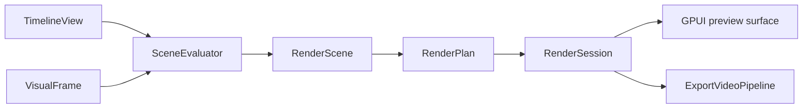

# Rendering

[Architecture](README.md) · [Editing](editing.md) · **Rendering** · [Media and export](media.md) · [Runtime](runtime.md)

[`engine/rendering`](../../crates/zerium/src/engine/rendering/) shares scene evaluation
and GPU rendering between preview and export.

[`SceneEvaluator`](../../crates/zerium/src/engine/rendering/scene/) resolves properties,
media requests, text, scene boundaries, and temporal samples.
[`rendering/gpu`](../../crates/zerium/src/engine/rendering/gpu/) lowers the resulting
scene into a render plan and submits its passes asynchronously.
[`RenderRuntime`](../../crates/zerium/src/engine/rendering/runtime.rs) manages the
preview session and creates independent export sessions.

## Scene evaluation and render planning

The evaluator calls the scene graph builder directly. `RenderScene` owns the
completed graph and output geometry. The builder resolves every effect pass and
its required temporal samples together, then creates a `RenderEffect` with its
complete input list. `RenderInput` pairs each shader input name with its node.
Media raster requests use the input source's properties and placement.

The planner interns nodes using descriptions that contain child identities rather
than nested keys. Unchanged nodes retain their identity from the previous frame;
older descriptions are discarded. Duplicate passes reuse their node before pass
data is allocated. Hashing and equality do not traverse the dependency graph.

For each evaluated scene scope, `SceneCompositionPlan` resolves layer-relative
render-result inputs, camera settings, and the nodes visible to each consumer.
Normal output and captures have separate node lists, so hiding an original does
not remove it from other capture dependencies. Render-graph construction consumes
these resolved captures without reinterpreting their property references.

## Images and bounds

Effects and blending use scene-linear, premultiplied color. Intermediate surfaces
are RGBA16Float; presentation uses RGBA8 sRGB. An item's effects run before its
image is blended into its parent. Scene-instance effects run after its children
are composited.

Each render, compute, and temporal reduction pass is a graph node with its own
logical output bounds. Scene bounds are the union of their children's bounds;
view nodes produce finite camera captures. Normal output and camera captures
share the same scene and effect nodes.

Shader nodes render their complete logical images. Composition and view nodes
select the region needed by their destination. Camera zoom changes raster density
without changing logical bounds. Complete intermediate images must fit the GPU
texture limit, so effects on widely separated groups can require large surfaces.

Images carry logical bounds, raster coverage, and sampling density through paired
texture and metadata bindings. Generated sampling functions use the pair for each
image, including media, text, and render results extending beyond the viewport.
Original sources and temporal accumulations are graph dependencies.

Native media and text frames use a separate image node and a renderer-owned
texture/sampler pipeline. They do not use plugin item properties or shader
registration. Uploaded textures and conversion targets are reused by the session.

`TextSignature` resolves text properties into the layout and style used for cache
identity. The text raster module owns font fallback, shaping, alignment, outlines,
and coloring. `TextFrameCache` retains reusable font/glyph resources and manages
frame reuse, pinning, and eviction within its byte budget.

## GPU resources

`RenderDevice` shares pipelines across sessions. Each `RenderSession` reuses frame
buffers, render targets, uploaded media, and rendered images.

Item data and item/pass properties are uploaded once per frame. Each shader node
supplies a small uniform for its current output size and raster extent. Composition
nodes own render targets without shader data buffers. Node resources do not copy
frame-wide item or property data.

Raster coverage and dimensions are resolved once, before cache lookup, allocation,
or uniform creation. One image key combines the stable node identity with this
coverage and raster grid. The surface cache shares results across consumers and
root layers, then retains frequently used results from the current frame within
a byte budget. Retained entries own their targets until eviction; other targets
return to the resource pool after submission. Native frame conversions are shared
within a frame independently of the consumer's grid; their targets remain owned
by the input texture pool.

Each node owns one output target. A non-normal composition acquires its backdrop
only when it is encoded. Queue ordering lets compositions of the same size share
one scratch backdrop, including nested compositions and root layers. Scratch
retention is bounded and drops sizes unused by the next frame.

`SurfaceOutput` resolves a node and consumer request to either a native frame or
a validated `SurfaceRaster`. Shader nodes retain their complete logical bounds;
composition and view nodes select coverage. Cache identity, allocation, and GPU
uniforms consume this same decision. Raster fields cannot be constructed outside
the surface resolver.

For the shader authoring contract, see
[Rendering and shaders](../plugin/rendering.md). Reader scheduling and output
encoding are covered in [Media, preview, and export](media.md).
